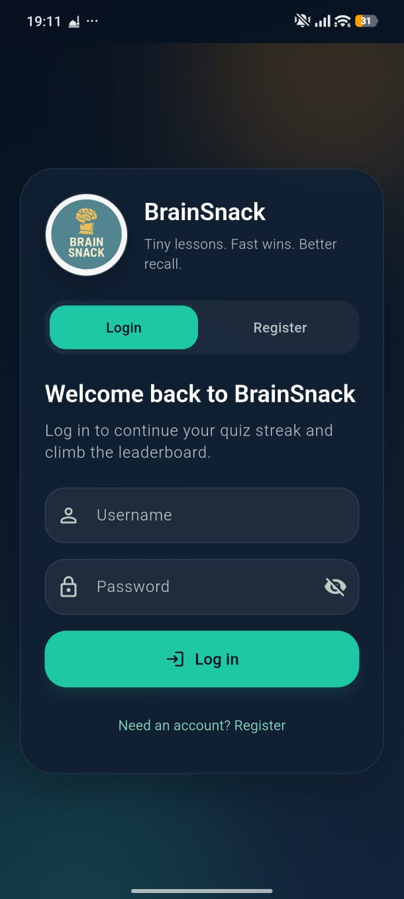
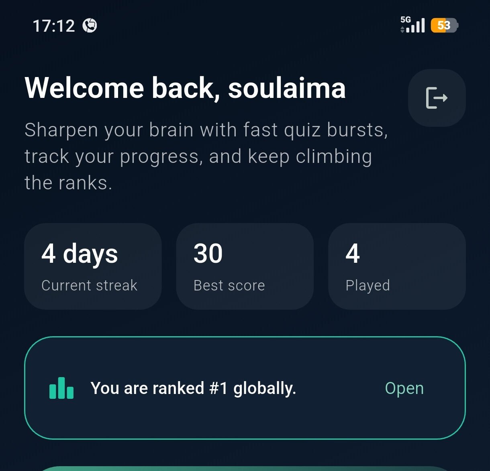
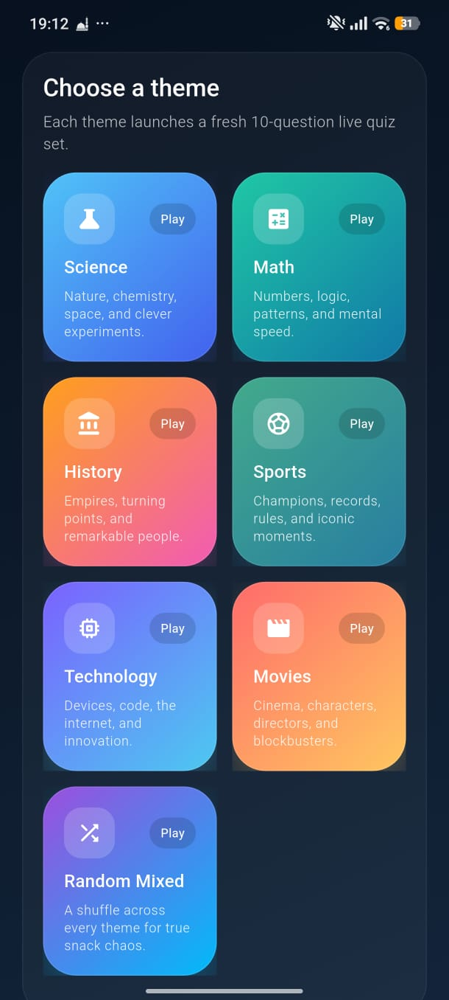
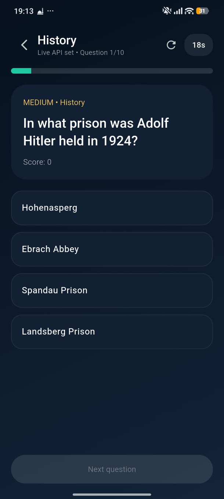
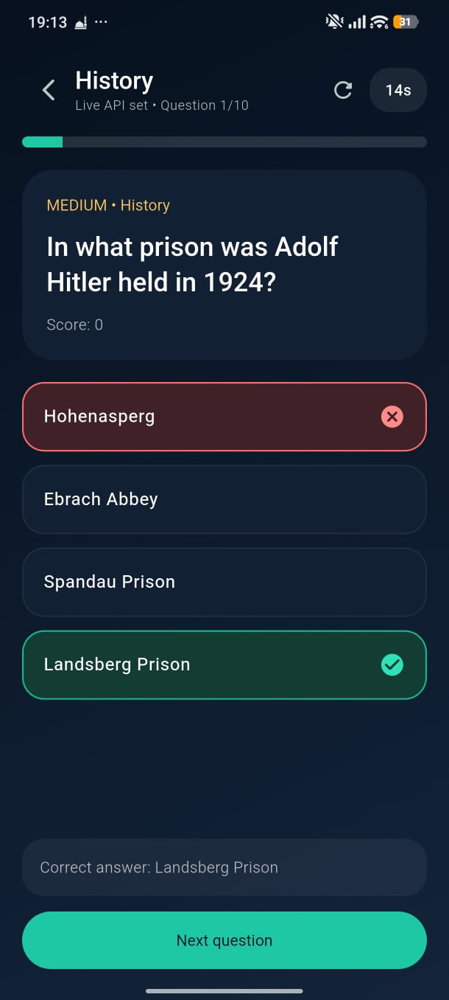
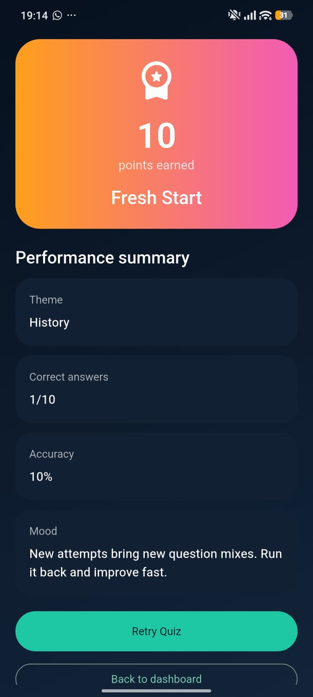
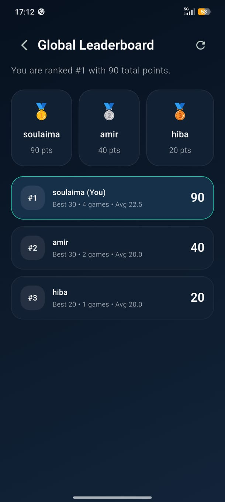

# BrainSnack

**BrainSnack** est une application de quiz gamifiée développée avec Flutter et Dart. Elle permet de lancer des parties courtes sur différents thèmes, de suivre ses résultats et de comparer les scores enregistrés sur le même appareil.

> L’interface actuelle de l’application est en anglais.

## Outils et technologies

| Outil / technologie | Rôle dans le projet |
| --- | --- |
| Flutter | Framework de l’application et de ses interfaces |
| Dart (`^3.10.7`) | Langage utilisé pour la logique et l’interface |
| Provider (`^6.1.5`) | Gestion de l’état et partage des données entre écrans |
| SQLite avec `sqflite` (`^2.4.2`) | Stockage local des comptes et des résultats |
| `http` (`^1.5.0`) | Appels HTTP vers l’API de quiz |
| `intl` (`^0.20.2`) | Présentation des dates dans l’historique |
| `path` (`^1.9.1`) | Construction du chemin du fichier SQLite |
| Material 3 | Base des composants et du thème graphique |
| `flutter_lints` (`^6.0.0`) | Analyse statique et conventions Dart |
| `flutter_test` | Infrastructure de tests Flutter présente dans le projet |
| `flutter_launcher_icons` (`^0.14.4`) | Génération des icônes depuis `assets/images/logo.png` |

### Outils de développement

- Flutter SDK et Dart SDK compatibles avec la contrainte du projet.
- Visual Studio Code avec les extensions Flutter et Dart, ou Android Studio avec ses plugins Flutter et Dart.
- Android SDK avec un émulateur ou un appareil Android pour lancer la cible Android.
- Git pour le suivi des versions.
- Connexion Internet pour installer les packages et charger les questions de quiz.

## Compétences techniques mobilisées

- Développement d’interfaces multiplateformes avec Flutter et Material 3.
- Gestion d’état avec Provider et séparation des responsabilités entre écrans, providers et services.
- Intégration d’une API REST avec `http`, lecture du JSON et gestion des erreurs réseau.
- Persistance et requêtes de données locales avec SQLite.
- Validation de formulaires, navigation entre écrans et gestion d’un compte à rebours.
- Calcul des scores, badges, statistiques et agrégation des résultats pour le classement.

## Architecture de travail

Le projet organise le code par responsabilités :

```text
lib/
├── auth/         # AuthService : création de compte, connexion et déconnexion
├── database/     # DatabaseHelper : schéma et requêtes SQLite
├── models/       # Utilisateur, question, catégorie, résultat et classement
├── providers/    # AuthProvider, HomeProvider, QuizProvider, LeaderboardProvider
├── screens/      # Connexion, accueil, quiz, résultats et classement
├── services/     # Questions API, authentification, résultats et classement
└── widgets/      # Cartes, boutons, options et composants réutilisables

assets/images/    # Logo et ressources graphiques
docs/screenshots/ # Captures d’écran du rapport technique
```

Le flux principal des données est :

```text
Écran Flutter → Provider → Service → API distante ou base SQLite locale
```

- Les écrans affichent les données et transmettent les actions de l’utilisateur.
- Les providers maintiennent l’état de l’application et mettent l’interface à jour.
- Les services portent les opérations de quiz, d’authentification, de résultats et de classement.
- `DatabaseHelper` crée et interroge les tables `users` et `scores`.

## API utilisée

BrainSnack récupère les questions depuis l’[Open Trivia Database (OpenTDB)](https://opentdb.com/), une API publique de questions de culture générale.

- **Requête :** `GET https://opentdb.com/api.php`
- **Paramètres utilisés :** `amount=10`, `type=multiple` et, selon la catégorie, `category=<identifiant>`.
- **Catégories OpenTDB :** Science `17`, Math `19`, History `23`, Sports `21`, Technology `18`, Movies `11`. Le thème mixte ne transmet pas de catégorie.
- Les réponses incorrectes et la réponse correcte sont mélangées avant l’affichage. Quelques entités HTML courantes des questions et réponses sont décodées dans l’application.
- L’application applique un délai maximal de 12 secondes aux requêtes et réessaie les réponses HTTP `429` (limitation de débit).
- L’API sert uniquement à charger les questions. Les comptes, scores et classements restent dans SQLite sur l’appareil ; aucun serveur BrainSnack ni classement en ligne n’est configuré.

## Fonctionnalités principales

- Inscription et connexion par nom d’utilisateur et mot de passe.
- Sept thèmes : Science, Math, History, Sports, Technology, Movies et Random Mixed.
- Dix questions à choix multiples et 20 secondes par question.
- Correction après chaque réponse et 10 points attribués par bonne réponse.
- Résumé des performances et badge selon le score obtenu.
- Tableau de bord avec défi du jour, statistiques, historique et aperçu du classement.
- Classement local avec score total, meilleur score, moyenne et nombre de parties.

## Interfaces et captures d’écran

Les captures ci-dessous sont extraites du rapport technique fourni avec le projet. Chaque description correspond à l’interface et au comportement présents dans le code.

### 1. Connexion et inscription

L’écran d’authentification réunit les modes **Login** et **Register** dans un même formulaire. L’utilisateur saisit son nom et son mot de passe ; le mode inscription ajoute un champ de confirmation. Le formulaire vérifie que le nom contient au moins trois caractères, que le mot de passe en contient au moins quatre et que la confirmation correspond. Les erreurs d’authentification ou d’inscription sont affichées dans le formulaire, et le bouton indique l’état de chargement pendant la requête locale.

L’inscription est donc un mode de ce même écran et ne possède pas de capture distincte dans le rapport fourni.



### 2. Tableau de bord

Après connexion, l’accueil regroupe les informations de progression et les points d’entrée vers les autres fonctions. Il affiche le nom de l’utilisateur, la série de parties, le meilleur score et le nombre de quiz terminés. Si l’utilisateur apparaît dans le classement, sa position est mise en avant avec un bouton pour ouvrir le classement complet. L’écran comprend aussi une carte de défi quotidien, la grille des thèmes, un aperçu des joueurs en tête et l’historique des résultats. L’historique permet de supprimer une partie ; un geste de rafraîchissement recharge les données locales.



### 3. Choix d’un thème

La section **Choose a theme** est intégrée au tableau de bord, et non dans un écran séparé. Les sept cartes présentent un nom, une courte description, une couleur dégradée et un bouton de lancement. Le thème choisi détermine la catégorie transmise à OpenTDB ; **Random Mixed** demande des questions sans filtre de catégorie.



### 4. Partie de quiz

L’écran de jeu indique le thème, le numéro de la question, la progression et le temps restant. La question provient de l’API et les quatre propositions sont mélangées. Une fois une réponse sélectionnée, les choix sont verrouillés et l’option correcte est signalée. Le texte de correction affiche la bonne réponse. Le bouton de progression mène à la question suivante ou termine la partie après la dernière question. Si le chargement échoue, un état d’erreur propose de réessayer.



#### Retour après une réponse

La capture montre le feedback visuel : la réponse sélectionnée est colorée, la bonne réponse est indiquée et le panneau de correction révèle la réponse attendue avant de passer à la suite.



### 5. Résultats

À la fin de la partie, l’écran présente le score et le badge, puis un résumé avec le thème, le nombre de réponses correctes, la précision et un message lié à la performance. Les seuils de badges actuels sont : **Legend** pour 100 %, **Hot Streak** à partir de 80 %, **Quick Thinker** à partir de 50 %, et **Fresh Start** en dessous. **Retry Quiz** relance une partie sur le même thème ; **Back to dashboard** retourne à l’accueil.



### 6. Classement

Le classement complet affiche un podium pour les trois premiers, puis la liste ordonnée des joueurs. Chaque entrée indique le rang, le score total, le meilleur score, le nombre de parties et la moyenne. L’entrée du compte courant est mise en évidence. Un bouton ou un geste de rafraîchissement recharge les résultats issus de la base locale.



## Installation et lancement

### Prérequis

- Flutter installé et accessible dans le terminal (`flutter --version`).
- Un appareil ou un émulateur Android configuré (`flutter devices`).
- Une connexion Internet pour charger les questions depuis OpenTDB.

### Démarrer l’application

Depuis la racine du projet :

```bash
flutter pub get
flutter devices
flutter run -d <identifiant_de_l_appareil>
```

Pour utiliser l’appareil par défaut, lancez `flutter run` sans argument `-d`.

### Commandes utiles

```bash
flutter analyze                 # Analyse statique du code
flutter test                    # Lance les tests existants dans test/
flutter build apk --debug       # Génère un APK Android de débogage
dart run flutter_launcher_icons # Régénère les icônes de l’application
```

## Stockage et limites actuelles

- Les comptes et les scores sont sauvegardés localement dans SQLite.
- Le classement est local à l’installation et n’est pas partagé entre appareils.
- Une connexion Internet est nécessaire pour démarrer un quiz.
- La session utilisateur reste en mémoire ; l’utilisateur doit se reconnecter après le redémarrage de l’application.
- **Sécurité :** les mots de passe sont actuellement stockés en clair dans SQLite. Cette implémentation est adaptée à une démonstration, mais le stockage des identifiants doit être sécurisé avant toute utilisation en production.

Le dépôt contient des configurations Android, iOS, Windows et Web. Le parcours principal repose cependant sur `sqflite` ; chaque cible doit être vérifiée et adaptée si nécessaire avant une diffusion sur cette plateforme.

## Version

Version déclarée dans `pubspec.yaml` : **1.0.0+1**.

